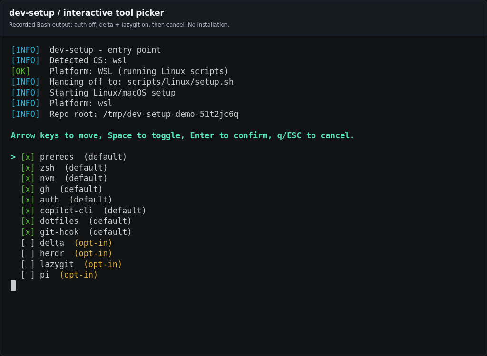

# dev-setup

Development setup for Debian/Ubuntu Linux, macOS, WSL, Windows and Dev Containers. Choose tools interactively or use repeatable selection flags.

**Setup changes your machine.** It installs software and can change shell configuration, dotfiles and profiles. Review the selected steps and [configuration/backup behavior](docs/setup.md#configuration-and-backups) before using it on a personalized machine.

## Quick Start

Clone into a location you intend to keep; some shell configuration links back to this checkout.

```sh
git clone https://github.com/primetimetank21/dev-setup.git
cd dev-setup
```

**Linux / macOS / WSL**

```bash
bash setup.sh
```

**Windows PowerShell 5.1 or newer**

```powershell
powershell -NoProfile -ExecutionPolicy Bypass -File .\setup.ps1
```

An eligible interactive terminal opens the tool picker. **CI/headless sessions install the defaults instead.** Dev Containers and Codespaces run setup on creation; see the [container guide](.devcontainer/README.md).

## What This Installs

| Selection | Includes |
|---|---|
| Common defaults | NVM/Node.js, GitHub CLI, Copilot CLI, dotfiles and repository Git hooks |
| Linux / macOS / WSL | Git, curl, Vim and Zsh; Linux also gets build tools |
| Windows | Git, Vim and PowerShell profile shortcuts |
| Opt-in tools | `delta`, `lazygit`, `pi`, `herdr` |

Pinned tool versions are defined in [`.tool-versions`](.tool-versions). Node targets the pinned version, not an implicit latest-LTS upgrade. Exact availability and order come from `--list` / `-List`.

## Selective Install



Recorded from tested Bash/WSL output; no installers ran. [Recording notes](docs/media/tui-demo/README.md).

List tools without installing anything:

```bash
bash setup.sh --list
```

Install a small explicit selection:

```bash
bash setup.sh --only=prereqs,nvm,gh
```

PowerShell equivalents:

```powershell
.\setup.ps1 -List
.\setup.ps1 -Only 'winget-check,git,nvm,gh'
```

Use the process-scoped PowerShell prefix from Quick Start if your session blocks scripts.

- `--only` / `-Only` selects named tools; **dependencies are not added automatically**.
- `--skip` / `-Skip` omits named defaults. It cannot be combined with `--only` / `-Only`.
- `--non-interactive` / `-NonInteractive` suppresses the picker; **it is not a dry run**.
- The picker can cancel without installing anything. Controls vary between Bash 3.2, newer Bash and PowerShell.

[Full flag reference, picker controls and examples](docs/setup.md#tool-selection)

## After Setup

Open a fresh terminal to load new shell/profile configuration. Run `gh auth login` if authentication was skipped. Merely sourcing an updated file may leave old aliases in an already-running shell.

[Post-setup checks and troubleshooting](docs/setup.md#after-setup)

## Shell Aliases

Shared shortcuts cover Git, GitHub CLI, npm and common utilities. Platform-specific differences are intentional; see the [shell reference](config/dotfiles/README.md#shell-aliases-and-functions).

### Opt-in Native Completion Cycling

Tab cycling is a separate Bash/Zsh opt-in; ordinary setup never enables it. macOS system Bash 3.2 supports forward Tab only. See [installation, disable and recovery instructions](config/dotfiles/README.md#opt-in-tab-completion-cycling-bash--zsh).

### Shutdown Helpers (Bash/Zsh)

Shutdown shortcuts affect the whole machine; under WSL they target the **Windows host**. Timed Windows shutdown can force applications closed and lose unsaved work. Read the [shutdown reference](docs/shutdown.md) before using them.

## Documentation

| For | Start here |
|---|---|
| Installing, selecting tools, backups and removal | [Setup guide](docs/setup.md) |
| Dotfiles, aliases and completion | [Shell configuration](config/dotfiles/README.md) |
| Contributors | [CONTRIBUTING.md](CONTRIBUTING.md) |
| Coding agents | [AGENTS.md](AGENTS.md) |
| Implementation details | [Architecture](ARCHITECTURE.md) |
| Release history | [Changelog](CHANGELOG.md) |
